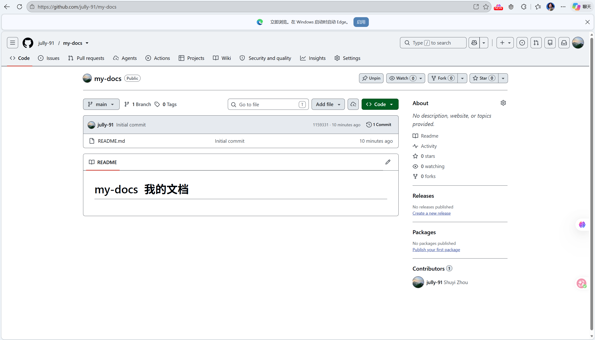
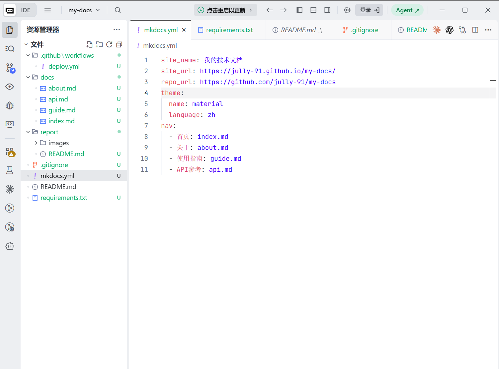
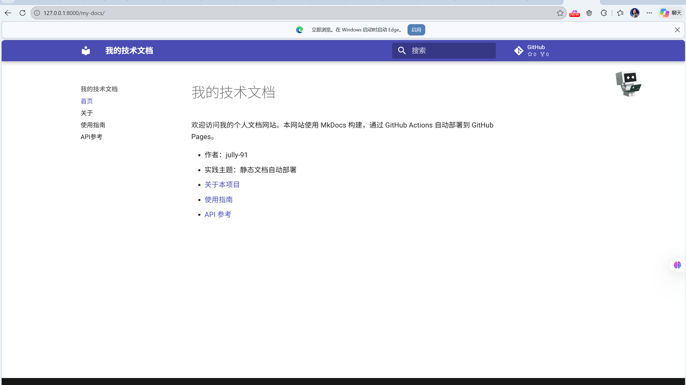
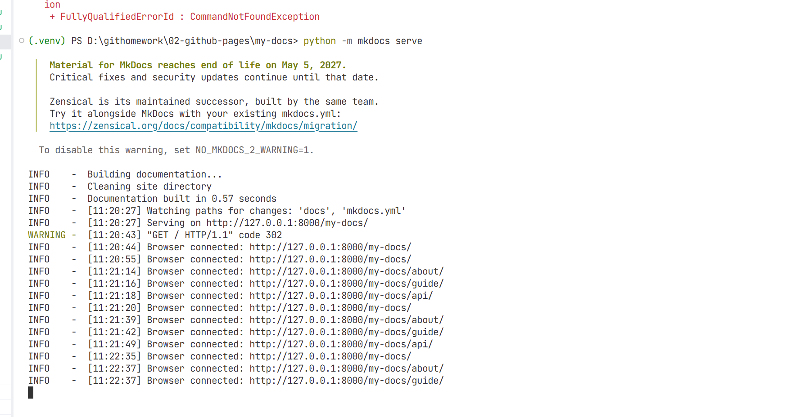
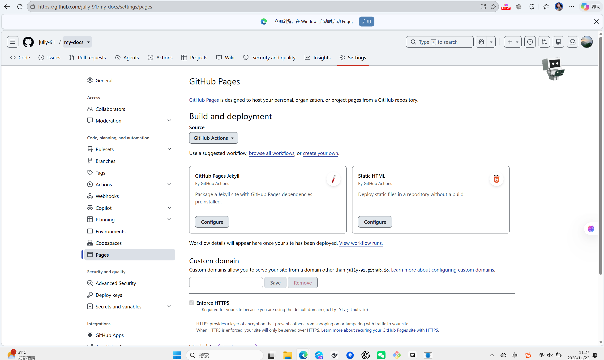
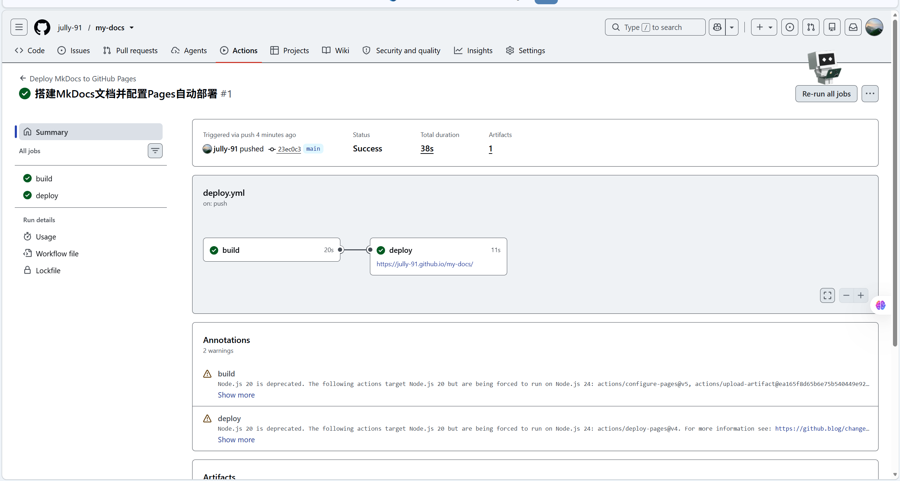
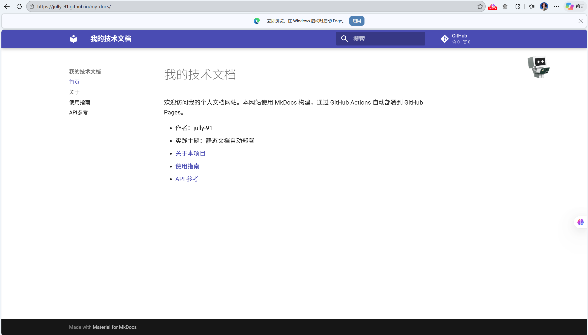
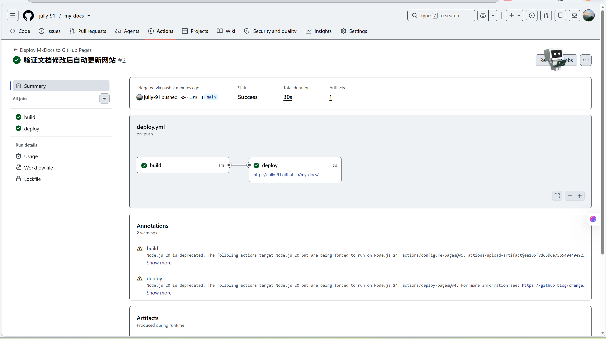
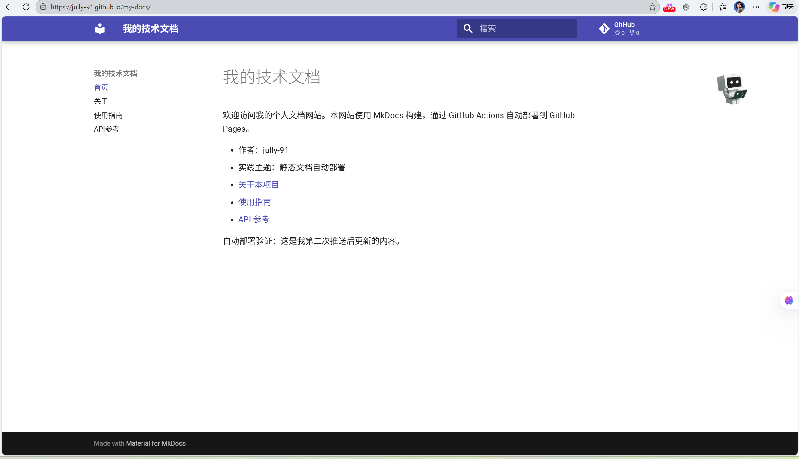
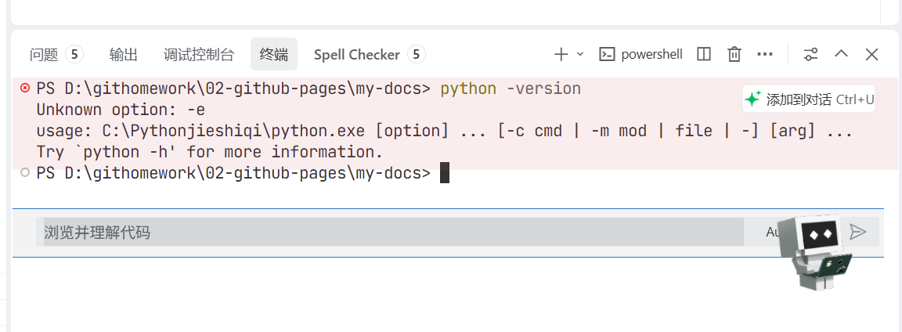

# 实践项目2：个人实验报告

## 1. 基本信息

- GitHub 登录名：`jully-91`
- 个人仓库地址：https://github.com/jully-91/my-docs
- 最终网站地址：https://jully-91.github.io/my-docs/
- 第二次自动部署的 Actions 运行地址：https://github.com/jully-91/my-docs/actions/runs/45123417799

## 2. 实践过程与关键截图

### 2.1 仓库创建

我使用自己的 GitHub 账号创建了公开仓库 `my-docs`，默认分支为 `main`。公开仓库用于保存文档源码、部署配置和实验报告，也便于通过链接核验作业。

### 2.2 项目结构与 MkDocs 配置

我在 `docs/` 中创建了首页、关于、使用指南和 API 参考四个 Markdown 页面；在 `mkdocs.yml` 中配置网站名称、Material 主题、站点地址和四页导航。`docs/` 保存网站源文档；`nav` 指定导航栏显示的页面及其相对于 `docs/` 的文件路径；`site/` 是 MkDocs 构建后自动生成的网页文件，供 Actions 上传部署，不需要手工修改或提交。`requirements.txt` 记录构建依赖，`.gitignore` 排除虚拟环境和 `site/`。

### 2.3 本地构建或预览

我在项目虚拟环境中安装依赖，运行 `python -m mkdocs build --strict`，构建成功；再运行 `python -m mkdocs serve` 打开本地网站。通过导航逐个查看了首页、关于、使用指南和 API 参考页，终端记录了四页的访问。本地虚拟环境使用 Python 3.14，GitHub Actions 则按工作流配置使用 Python 3.12。

### 2.4 设置 GitHub Pages

我在个人仓库的 `Settings → Pages` 中将发布来源 `Source` 设为 `GitHub Actions`，使仓库使用自定义工作流发布 MkDocs 构建结果。

### 2.5 Actions 首次构建和部署

我将文档、配置文件和 `.github/workflows/deploy.yml` 提交并推送到 `main`。工作流由推送自动触发，`build` 和 `deploy` 两个任务都成功；`build` 生成并上传 `site/`，`deploy` 将其发布为 GitHub Pages 网站。首次运行记录：https://github.com/jully-91/my-docs/actions/runs/45122680914 。

### 2.6 网站访问与四页导航检查

首次部署后，我访问了 https://jully-91.github.io/my-docs/ 。首页正常显示，左侧可见四页导航。我逐个打开“关于”“使用指南”“API 参考”页面，确认四页均能正常加载，导航和页面链接可用。

### 2.7 第二次推送与自动更新验证

我在 `docs/index.md` 增加了“自动部署验证：这是我第二次推送后更新的内容。”，然后再次提交并推送到 `main`。这次 `push` 自动触发新的工作流；`build` 和 `deploy` 均成功。刷新公开网站后，首页出现新增文字，说明文档修改已自动发布。

- 对应提交：https://github.com/jully-91/my-docs/commit/6c010cdee26d5382b8e8c923e5d9cec8d3b77d0b
- 对应 Actions 运行：https://github.com/jully-91/my-docs/actions/runs/45123417799

## 3. 问题与解决

1. 起初把配置文件命名为 `mydocs.yml`，与 MkDocs 默认读取的 `mkdocs.yml` 不一致。发现后重命名，并检查了导航路径和 YAML 缩进。
2. 检查 Python 版本时误输入 `python -version`，出现 `Unknown option: -e`。改用 `python --version` 后正常显示版本。启动预览时还曾误输入 `\python`，改为 `python -m mkdocs serve` 后成功启动。
3. Actions 运行详情出现 Node.js 20 弃用提示，但两次运行的 `build`、`deploy` 状态均为 `Success`，网站可访问。该提示没有阻止本次部署。

## 4. 原理理解

1. **`docs/` 和 `site/` 各保存什么？**

   `docs/` 保存我编写的 Markdown 源文档；`site/` 是 MkDocs 根据源码和配置自动生成的网站文件。修改源文档后可重新生成 `site/`，因此不用手工修改或提交它。

2. **工作流什么时候自动运行？**

   向 `main` 推送且变更包含 `docs/**`、`mkdocs.yml`、`requirements.txt` 或工作流文件时自动运行；也可通过 `workflow_dispatch` 手动启动。

3. **`build` 和 `deploy` 有什么区别？**

   `build` 取回源码、安装依赖、构建并上传网站产物；`deploy` 在构建成功后，把产物发布到 GitHub Pages。

4. **只修改 `report/README.md` 会触发部署吗？**

   不会，因为工作流的 `paths` 列表不包含 `report/**`。

5. **为什么不需要 `gh-pages` 分支？**

   本方案使用 GitHub 官方 Pages Actions：直接上传 `site/` 产物，再由部署任务发布，发布来源已经设为 GitHub Actions。

## 5. 个人实践体会

这次实践让我理解了文档源码与公开网站之间的关系：我在 `docs/` 中修改 Markdown，MkDocs 把它构建成 `site/`，GitHub Actions 再把构建结果发布到 Pages。遇到问题时，我先看命令行报错和文件名，例如把 `mydocs.yml` 改为 `mkdocs.yml`、把误输入的 `python -version` 改为 `python --version`，再重新运行构建和预览。首次发布只能说明工作流运行成功；第二次修改首页并推送后，我看到新的 Actions 运行自动开始，部署成功后公开网页也出现了新文字，因此确认了“修改文档—推送—自动构建—网站更新”的完整过程。
